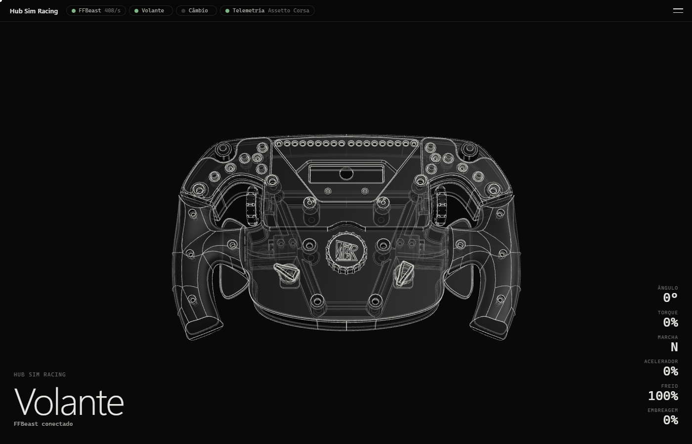
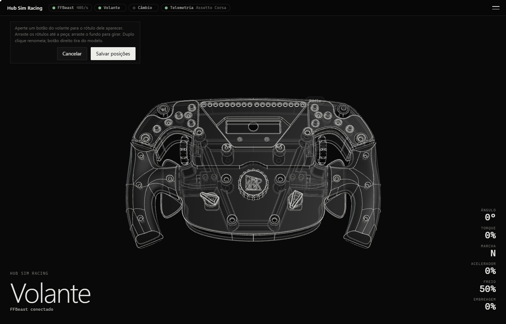
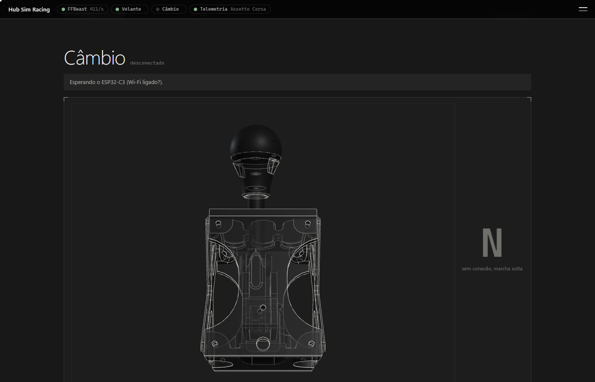
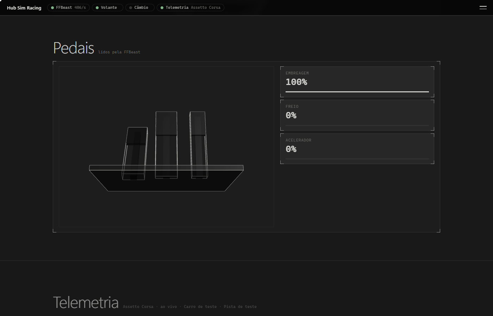
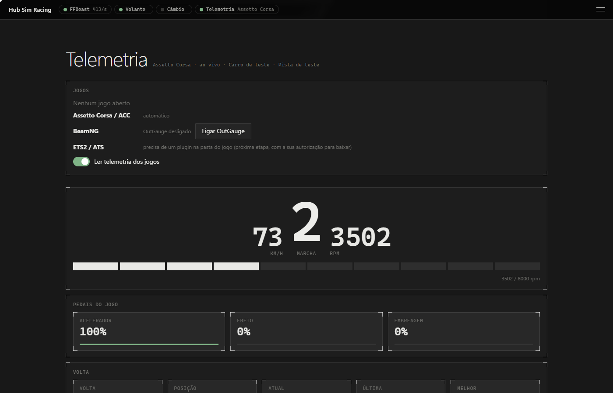
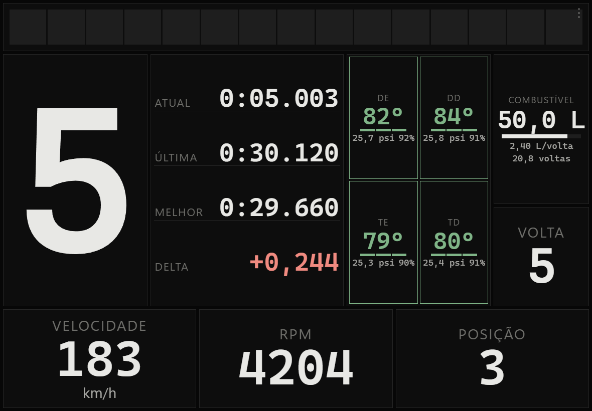

# Hub Sim Racing

**O acabamento de um equipamento comercial para o seu sistema DIY de sim racing.**

Sua base direct drive, o volante, o câmbio e os pedais numa janela só, para Windows. Gratuito e de código fechado.

[**Baixar a última versão**](https://github.com/MatheusBraga1106/hub-sim-racing/releases/latest) · [Site com prints e requisitos](https://matheusbraga1106.github.io/hub-sim-racing/) · [Todas as versões](https://github.com/MatheusBraga1106/hub-sim-racing/releases)

## O que ele faz

- **Tudo em 3D.** O volante do topo gira no mesmo sentido do físico e mostra ângulo, força no volante, marcha e pedais. Dá para exportar aro, câmbio e pedais do seu projeto no Fusion.
- **Base FFBeast.** Leitura contínua do ângulo e dos pedais, força que o jogo manda ao volante com o torque estimado em Nm e os ajustes do dia a dia na mesma tela. Nada vai para a base sem o clique em Aplicar, no PC.
- **Telemetria dos jogos.** Assetto Corsa, ACC e BeamNG.drive: marcha, RPM, pedais, tempos, pneus e mapa da pista, sem plugin.
- **O celular vira painel.** Dashboards em tela cheia para celular ou tablet, pareados por QR code, com editor de arrastar e soltar.
- **Qual é o botão?** Busque "36" ou "ignição" e veja a função de cada botão no Assetto Corsa, no ETS2 e no BeamNG.
- **Calibração dos pedais.** Um assistente mede repouso e curso, sugere mínimo e máximo, e cancelar devolve o que a base tinha.

| Volante | Câmbio | Pedais |
|---|---|---|
|  |  |  |

| Telemetria | Botões | Painel no tablet |
|---|---|---|
|  |  |  |

Prints tirados do modo de teste, com dados simulados.

## Requisitos

- Windows 10 ou 11, 64 bits.
- WebView2 (já vem no Windows 11 e na maioria dos Windows 10 atualizados; o hub avisa se faltar).
- Uma base FFBeast (firmware 24.1.4) ou os outros aparelhos que quiser ver no hub. Sem nenhum aparelho, o hub abre e mostra o que falta ligar.
- Sem senha de administrador: a instalação é só para o seu usuário.

## Instalação

Baixe o instalador na [página de versões](https://github.com/MatheusBraga1106/hub-sim-racing/releases/latest), abra e siga Avançar até Concluir. O hub aparece no menu Iniciar e, quando sair versão nova, avisa e atualiza com um clique, sem perder ajustes, dashboards e modelos.

**Aviso do Windows (SmartScreen).** O instalador não é assinado com certificado pago de editor, então o Windows pode mostrar "O Windows protegeu o computador". Clique em **Mais informações** e depois em **Executar assim mesmo**.

Para conferir o arquivo, compare o SHA-256 da página do site com o resultado de `Get-FileHash NomeDoInstalador.exe` no PowerShell. As atualizações automáticas também são verificadas por assinatura.

## Sobre este repositório

Este repositório guarda só o **site** (GitHub Pages) e os **instaladores**. O código-fonte do app é privado. Feito por [Matheus Braga](https://github.com/MatheusBraga1106). O guia técnico dos padrões de interface 3D usados aqui está em [3d-web-dev-skills](https://github.com/MatheusBraga1106/3d-web-dev-skills).
